<div align="center">



</div>

<div align="center">

</div
  
</details>


  
````
class Stack:
    llm       = ["vLLM", "LoRA", "HuggingFace", "RAG"]
    inference = ["TensorRT", "Triton", "ONNX", "Flash Attn"]
    ml        = ["PyTorch", "JAX", "Scikit-learn"]
    vision    = ["YOLOv8", "CLIP", "SAM"]
    ops       = ["Docker", "K8s", "MLflow", "AWS"]

    def status(self):
        return "Weights never frozen."
````

</details>

<div align="center">

</div>
